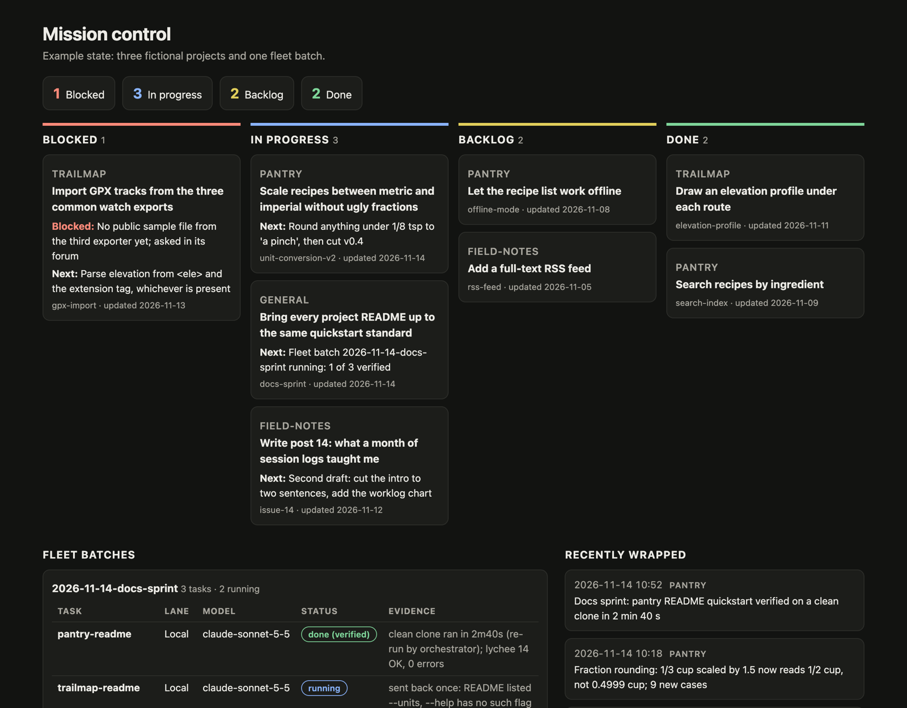
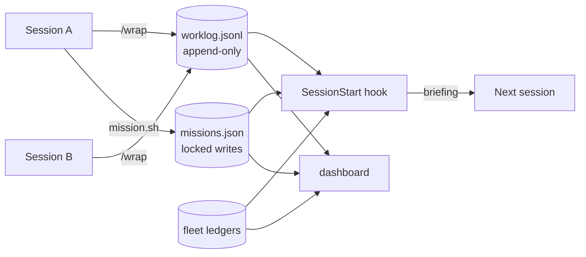

# atlas-kit


[](https://github.com/Logan-Cope/atlas-kit/actions/workflows/ci.yml)
[](https://logan-cope.github.io/atlas-kit/)

Run five Claude Code sessions at once and none of them knows what the other four did. atlas-kit gives them one shared state: every session starts with a briefing of what's open, records what it finished with `/wrap`, and one session can run a batch of others with `/fleet` and check their work before calling it done.

It's a few small scripts, three skills and plain files. No server, no database, no API key.

## What's in it

| Piece | What it does |
|---|---|
| `state/missions.json` | Open work: one mission per piece of work, with status, next action and blocker |
| `state/worklog.jsonl` | Append-only log, one line per finished unit of work, from every session |
| `state/decisions.jsonl` | Append-only ledger of decisions and why they were made |
| `state/fleet/<batch>.md` | One ledger per fleet batch: each task, its owner session, status and evidence |
| `bin/session-start.sh` | SessionStart hook: prints open missions, recent wraps and running fleet batches into every new session |
| `bin/mission.sh` | The only writer of `missions.json`: locked, atomic, rebuilds the dashboard |
| `bin/worklog.sh` | Appends to and reads the worklog |
| `bin/build-dashboard.py` | Renders the state to one static HTML page ([live example](https://logan-cope.github.io/atlas-kit/)) |
| `/wrap` | Skill: close the loop at the end of a unit of work |
| `/today` | Skill: where things stand and the one thing to do first |
| `/fleet` | Skill: one orchestrator session plans a batch, starts a child session per task, judges the evidence and sends back what isn't done |

## Quickstart

Needs bash, `jq` and `python3`.

```bash
git clone https://github.com/Logan-Cope/atlas-kit.git
cd atlas-kit

# Try it on the example state without installing anything
ATLAS_STATE=examples/state bin/session-start.sh
python3 bin/build-dashboard.py --state examples/state --out /tmp/atlas-dashboard.html

# Run the tests (about 10 seconds)
./tests/run.sh
```

Install for real:

```bash
./install.sh --hook        # scripts to ~/.atlas, skills to ~/.claude/skills, hook into settings.json
```

State lives in `~/.atlas/state` (set `ATLAS_HOME` before installing to put it elsewhere). `--hook` backs up `~/.claude/settings.json` before adding the SessionStart hook, and running it twice adds it once. Leave it off and the installer prints the snippet to paste instead. `--example` starts you on the example state. Existing state and skills with the same names are never overwritten (`--force` overwrites the skills).

Then, in any Claude Code session:

```
/today                      where things stand, and what to do first
/wrap                       record what you just finished
/fleet <three tasks>        run them as three sessions and check the results
```

`/fleet` starts each child with `claude --bg` (or as a subagent when the task is small), tracks it in a ledger under `state/fleet/`, and re-runs the child's checks before marking it verified.

## The dashboard



`mission.sh` rebuilds it on every change, at `~/.atlas/dashboard/index.html`. It's one HTML file with no JavaScript, so it opens from disk. The [example](https://logan-cope.github.io/atlas-kit/) is built from `examples/state` by the Pages workflow.

## How it works



The details, including the fleet lanes, are in [docs/ARCHITECTURE.md](docs/ARCHITECTURE.md). Why it's built this way (append-only, one writer script, judging evidence instead of claims) is in [docs/DESIGN-NOTES.md](docs/DESIGN-NOTES.md).

## Guardrails

- Sessions append to the worklog and never rewrite it, so two sessions can't overwrite each other's entries. The tests run 40 appends at once and check all 40 land whole.
- `missions.json` changes only through `mission.sh`, which takes a lock and swaps the file atomically. Without the lock, 4 of 20 concurrent edits survive in the tests; with it, 20 of 20.
- Text you pass in is data, never code: a next action containing jq syntax is stored literally (tested).
- The hook never fails a session start. With no state, it prints nothing.
- Fleet children own disjoint files, and anything that sends a message outward is drafted to a file for you to send.

## License

MIT
