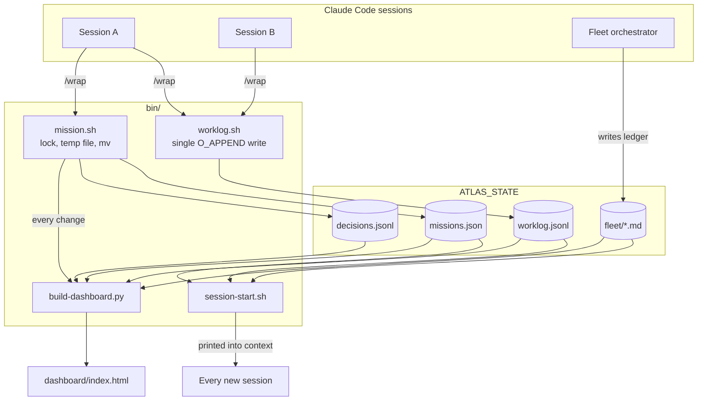
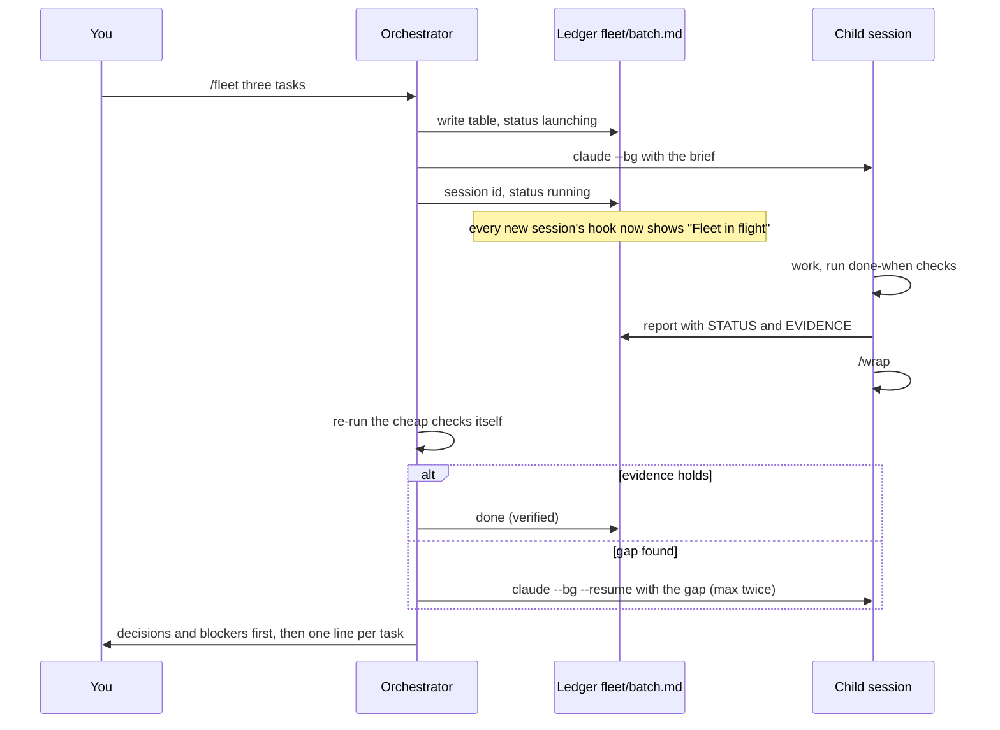

# Architecture

atlas-kit has three layers: plain files that hold the state, small scripts that are the only things allowed to write them, and Claude Code hooks and skills that read and write through those scripts.

## The state spine

Everything lives in one folder, `$ATLAS_STATE` (default `~/.atlas/state`).

| File | Shape | Written by | Read by |
|---|---|---|---|
| `missions.json` | `{updated, missions: [{id, title, project, status, next_action, blocker, updated}]}` | `mission.sh` only | the hook, `/today`, the dashboard |
| `worklog.jsonl` | one JSON object per line: `ts, project, summary, missions[], files[], source` | `worklog.sh add` (append) | the hook, `/today`, the dashboard |
| `decisions.jsonl` | one JSON object per line: `ts, mission, project, decision, why` | `mission.sh decision` (append) | `mission.sh decisions`, the dashboard |
| `fleet/<batch>.md` | a markdown table, one row per task | the `/fleet` orchestrator | the hook, the dashboard |
| `fleet/<batch>/<task>-report.md` | `STATUS / EVIDENCE / FOR YOU` | each fleet child | the orchestrator |

Status values for a mission: `backlog`, `in_progress`, `blocked`, `done`. Status values for a fleet task: `launching`, `running`, `done (verified)`, `partial`, `blocked`.

## Writers

**`worklog.sh add`** builds the line with `jq -n --arg ...`, so every value is escaped, then appends it with one `printf >>`. A single small write to a file opened with `O_APPEND` lands whole even when other processes append at the same moment. There is no read-modify-write, so there is nothing to lose.

**`mission.sh`** does need read-modify-write, because it changes one mission inside a JSON document. Every write:

1. takes a lock with `mkdir missions.json.lock` (atomic everywhere, and macOS has no `flock` command); a lock older than a minute is treated as left by a crashed writer and cleared,
2. checks the mission exists, so a typo in an id fails loudly instead of doing nothing,
3. runs a jq filter with every user value passed as `--arg`, never spliced into the filter,
4. writes the result to a temp file in the same folder and `mv`s it over the original, so a reader never sees half a file,
5. restamps `updated`, releases the lock, and rebuilds the dashboard.

`mission.sh decision` appends to its own ledger instead, the same way the worklog does. It never touches `missions.json`, so logging a reason doesn't change a mission's `updated` date.

## The hook

`session-start.sh` is registered as a Claude Code `SessionStart` hook. Its stdout becomes context for the new session. It prints:

- every `in_progress` and `blocked` mission, blocked first, with its blocker and next action,
- the last four worklog lines, from any session,
- every fleet ledger modified in the last two days that still has a `running` or `launching` row.

It exits 0 on every path. A missing state folder, a missing `jq` or a malformed file prints less, never an error.

## Skills

| Skill | Reads | Writes |
|---|---|---|
| `/wrap` | `mission.sh list` | `worklog.sh add`, `mission.sh next/done/block/add/decision` |
| `/today` | missions, `worklog.sh recent`, fleet ledgers, `mission.sh decisions` | nothing |
| `/fleet` | its ledger, child reports, `claude agents --json --all` | its ledger; children write their own files, reports and wraps |

## Fleet

One session is the orchestrator. It writes a task table where every task has pass/fail done-when checks and a set of files it owns, then starts one child per task.

| Lane | When | How it starts |
|---|---|---|
| Local | needs local files, the state folder, local skills | `claude --bg --name fleet-<batch>-<task> "<brief>"` |
| Cloud | code in one GitHub repo, laptop can close | a cloud session on a fresh clone; ends in a PR |
| Subagent | under about 15 minutes | the Agent tool inside the orchestrator |

Rules the skill enforces: owned file sets never overlap, at most four Local children at once, the tree stays two levels deep, and a task sent back twice is marked `blocked` instead of looping.

## Dashboard

`build-dashboard.py` is standard-library Python. It reads the state folder and writes one HTML file with inline CSS and no JavaScript: missions as four columns, fleet batches as tables, the last eight wraps and the last six decisions. Every value from state is HTML-escaped, and a bad line in a JSONL file is skipped instead of hiding the rest. `--no-timestamp` makes the output byte-for-byte reproducible, which the tests check.
